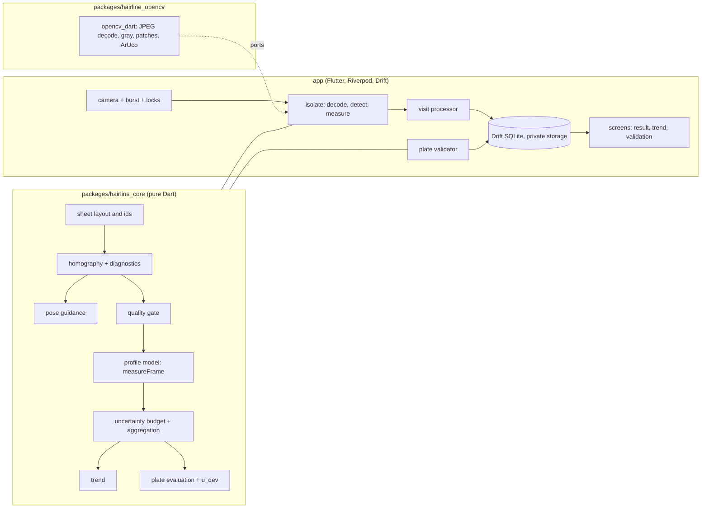

# Hairline

Longitudinal crack-width monitoring for non-professionals, Android first (Flutter). Owner and copyright holder: Vassel Goleyu. MIT license.

## Honest statements (read first)

- Results are INDICATIVE and do not replace inspection by a structural engineer. The app does not assess building safety and never shows the words "safe" or "harmless". If a crack appears to widen, lengthen, or a new crack appears, contact an engineer or the authorities.
- "No change detected" means any change is smaller than the measurement uncertainty. It is not proof that the crack did not change.
- Accuracy numbers carry their origin: `SINTETIS` (from simulation) or `PERANGKAT` (from plate validation on a real phone by the owner). No unlabeled accuracy figure exists in this repository (checked by `tools/audit/doc_checks.py`), and **no `PERANGKAT` figure exists yet**: the author has no phone, camera, or printed plate in the development environment. Every number below is `SINTETIS`.
- Claims about literature and competitors in the original specification (a Witteveen+Bos app, a 5 mm camera-shift error, an add-on lens for 0.3 to 1 mm at 2 m) are reported, not verified. This README makes no comparison with any product.
- Hairline does not accurately measure cracks that are not coplanar with the marker sheet, and is not suitable for regulatory decisions.
- The checked-in `app/` has no marker detector wired in (the native OpenCV build cannot run on every host, BLOCKERS B1). A phone build must use `tools/build_device_apk.sh` (see [Release build](#release-build)); its detection has never run on a real camera. See [Status](#status).

## The problem

A crack gauge that a non-professional can use repeatedly is hard: a phone photo has unknown scale and perspective, the phone is never held the same way twice, and a single width number without an uncertainty is easy to over-read. Monitoring needs a change to be compared with how well the width was measured, not with zero.

## The solution

A printed sheet of ArUco markers (known size) is glued flat around the crack. On every visit the app guides the phone pose, takes a burst with focus and exposure locked, rectifies the photo to the sheet plane with a homography, measures the crack width at one marked point with a sub-pixel profile model, computes an uncertainty budget, and compares the visit with the earlier ones. A change is flagged only when it exceeds the combined uncertainty. Extra hardware: none besides the printed sheet.

## How it works

1. **Homography and diagnostics.** The sheet has four 30 mm `DICT_4X4_50` markers at (+-60, +-60) mm around a 70 x 70 mm cut-out window. Three or more detected markers give a sheet-to-image homography (normalized DLT, then Levenberg-Marquardt on the reprojection error) with diagnostics: `rms_px`, leave-one-marker-out error `loo_mm`, local scale `mm_per_px`, scale anisotropy, and an approximate tilt from homography decomposition.
2. **Pose guidance and quality gate.** The live overlay compares the current pose with the baseline visit (translation, scale, in-plane rotation, tilt) and gives one instruction at a time. A burst of 6 photos is taken with focus and exposure locked. A frame is accepted only if markers, reprojection error, tilt, scale, blur, saturation and crack contrast pass named thresholds; the rejection reason is shown ("too blurry", "too tilted", "markers covered"). At least 3 accepted frames make a visit.
3. **Profile model.** The measurand is the mean crack width over a 4 mm segment centred on the marked point, measured perpendicular to the crack centreline, in mm on the sheet plane. Forty profiles are sampled in metric space (bicubic interpolation through the homography) and fitted with `I(s) = B + m s - D [Phi((s-c+w/2)/sigma) - Phi((s-c-w/2)/sigma)]`, where `sigma` is the camera blur measured from the marker edges. A two-pass fit (per-profile centre, then the aligned mean) gives the width and its covariance. A contrast gate refuses to return a number when the crack is not clearly above the noise.
4. **Uncertainty budget.** Per visit: statistical (fit and repeatability), blur (`u_sigma_w`), position, parallax (surface relief), sheet geometry, print scale, and device (`u_dev`) combine into `u_c`; the expanded uncertainty `U = k u_c` uses Welch-Satterthwaite and Student t. A width under `max(0.5 mm/px, 2 u_c)` is shown as "below the measuring limit", not as a number. Results carry `BELUM_DIVALIDASI` until the phone is validated on the plate.
5. **Trend.** For visit `i` against the baseline (and the previous visit): `delta = w_i - w_0`, `u_delta = sqrt(u_rand_i^2 + u_rand_0^2 + (delta u_print_rel)^2)` (shared systematic parts cancel), `z = delta / u_delta`. `|z| < 2` is "no change detected", otherwise "possibly widening" or "possibly narrowing"; the minimum detectable change `2 u_delta` is shown. No regression or extrapolation (2 to 5 visits). This is not an alert system.



`opencv_dart` is used only for JPEG decoding, grayscale conversion, patch extraction and ArUco detection; all geometry and measurement are in `hairline_core`.

## Synthetic study (label: SINTETIS)

Full chain on simulated photos (random pose, corner noise 0.2 px, a renderer with exactly known widths; label SINTETIS): 864 conditions (width 0.1 to 2.0 mm, 0.04 to 0.15 mm/px, blur, noise, tilt 0 to 20 degrees) x 5 replications for calibration plus 1 hold-out, seed 20261117, algorithm `p3-1`. Details and caveats: [docs/SYNTHETIC_VALIDATION.md](docs/SYNTHETIC_VALIDATION.md).

- The variance inflation factor `rho = 1.0` is supported (no inflation needed): coverage of the default expanded uncertainty was 100 percent over 3080 measurable calibration visits and 100 percent on the hold-out, with no condition significantly below 90 percent.
- Honest reading: the default `U` is about 20 times wider than the actual error in simulation (conservative, driven by the unvalidated `u_dev` and the relief term). The simulation has no hand shake, no ISP sharpening, and no real JPEG pipeline. This says nothing about coverage on a phone.
- Trend unit study (20000 replications): false positives 4.61 percent against a nominal 4.55 percent; detection at the minimum detectable change 50.4 percent, at twice it 97.7 percent.
- Plate validation, application level: the plate pipeline (32 lines per photo, evaluation, `u_dev`) is tested on synthetic photos only; the tests prove the pipeline works and that simulated runs are stored as `SINTETIS`, never as `PERANGKAT`.

## Making and mounting a sheet

1. Home screen, add a site, add a crack: the guided setup walks through printing (A4 or Letter, **100 percent, never "fit to page"**), measuring the 100 mm scale bar with a ruler (the reading gives `print_scale` and its uncertainty), cutting the window, mounting, and choosing the relief (0.3 or 1.0 mm).
2. Glue the sheet permanently and flat on the same plane as the crack, with the crack inside the 70 x 70 mm window. If the sheet moves or is removed, the series is broken: start a new crack.
3. First visit (baseline): capture, then tap the crack on the photo to set the measurement point (it must be inside the central 50 x 50 mm).

## Running the plate validation

The validation plate (sheet 11) has the identical marker layout and 32 black lines of nominal widths 0.1 to 2.0 mm (2 orientations x 2 positions). Printed line widths differ from nominal (toner or ink spread), so the truth should be **characterized**: scan the plate on a flatbed at 1200 to 2400 dpi and run the same core measurement on the scan:

```
cd tools && dart pub get
dart run measure_scan.dart --image scan.pgm --dpi 2400 --origin X,Y --out truth.csv
```

(`magick scan.tif -colorspace Gray scan.pgm` makes the PGM; `--origin` is the pixel of the window centre.) Then in the app: validation icon on the home screen, print the plate, read the scale bar, paste the `truth.csv` content, and capture at the distance and light you use on cracks. Without a CSV the nominal widths are used with a placeholder `u_truth` of 0.05 mm, labeled "NOMINAL (tidak dikarakterisasi)", and such a run **never** validates the phone. The result screen shows bias, RMSE, coverage and the empirical lower reporting limit per width. A `PERANGKAT` run with characterized truth, at least 16 measured lines, at least 4 widths, and coverage of at least 90 percent sets `u_dev` for that phone model and removes the `BELUM_DIVALIDASI` label from new measurements. A run on the simulated camera is stored as `SINTETIS` and changes nothing. Thresholds and reasoning: DECISIONS D46.

## Limits

- One measurement point per crack (the schema allows more; the feature does not exist).
- The crack must be coplanar with the sheet; surface relief enters the budget (`u_par`) but is not measured.
- Not a safety assessment; no crack length, area, or severity.
- Android only (minSdk 24). iOS is not targeted and not verified.
- Real camera behaviour (locks holding, CameraX orientation, performance, heat), OpenCV on device, printing, and device accuracy are **not verified**: [docs/DEVICE_TEST.md](docs/DEVICE_TEST.md) is the manual test list.
- Offline only: the release manifest declares only `CAMERA`, no `INTERNET`.

## Release build

Two builds exist on purpose (DECISIONS D48):

```
# Host-verifiable build: no marker detector (used by CI and `make verify`).
cd app
flutter build apk --release

# Phone build with the OpenCV marker detectors wired in (compiles OpenCV from source,
# needs cmake and ninja; the first build takes tens of minutes):
make apk-device              # or: tools/build_device_apk.sh --target-platform android-arm64
adb install -r app/build/app/outputs/flutter-apk/app-release.apk
```

R8 and resource shrinking are on. Signing: copy `app/android/key.properties.example` to `app/android/key.properties` (git-ignored), create a keystore with the `keytool` command in that file, and rebuild. Without `key.properties` the build is signed with the debug key: fine for testing, not for distribution. Never commit a keystore. Application backup is disabled (`allowBackup="false"` plus data extraction rules), so photos and measurements never leave the phone except by an explicit user action.

## Comparison with other products

None. Competitor and literature claims in the original specification are unverified (see above), and no head-to-head measurement exists.

## Demo (phone and paper)

Print a sheet, glue it around a real or drawn crack, add the site and crack in the app, take the baseline, tap the crack, and repeat on later days following the ghost outline. Without a camera, `cd app && flutter run -t lib/main_fake.dart` runs the whole flow on synthetic photos, including the plate validation (stored as `SINTETIS`).

## Status

| Item | Status |
|---|---|
| 1 Sheet PDF, mounting guide, print-scale check | SELESAI-TERVERIFIKASI (geometry, vector PDF); real print: SELESAI-PERLU-UJI-PERANGKAT |
| 2 Marker detection and homography | homography and diagnostics TERVERIFIKASI-SINTETIS (and recomputed independently, docs/AUDIT.md); `opencv_dart` detection wired only in the phone build (`make apk-device`); its 13 adapter tests pass on an Android arm64 emulator (`make opencv-device-test`), not yet on a physical phone or a real camera stream: SELESAI-PERLU-UJI-PERANGKAT |
| 3 Pose guidance, burst, quality gate | logic SELESAI-TERVERIFIKASI / TERVERIFIKASI-SINTETIS; real camera SELESAI-PERLU-UJI-PERANGKAT |
| 4 Crack width at one point | TERVERIFIKASI-SINTETIS; real photos SELESAI-PERLU-UJI-PERANGKAT |
| 5 Local storage (Drift) | SELESAI-TERVERIFIKASI |
| 6 Trend, 2 to 5 visits | TERVERIFIKASI-SINTETIS |
| 7 Plate validation | pipeline TERVERIFIKASI-SINTETIS (plate generator, CSV import, scan tool, validation mode, `u_dev`); real accuracy SELESAI-PERLU-UJI-PERANGKAT |
| 8 Pure Dart core | SELESAI-TERVERIFIKASI |

Phase 9 independent audit (PASS/FAIL per item, with evidence): [docs/AUDIT.md](docs/AUDIT.md). Detailed progress: [docs/PROGRESS.md](docs/PROGRESS.md). Decisions: [docs/DECISIONS.md](docs/DECISIONS.md). Run `make verify` for the standard checks.

## Layout

- `packages/hairline_core`: pure Dart core (no Flutter, no OpenCV).
- `packages/hairline_opencv`: OpenCV adapters (analyzed; native tests not run on the development host).
- `app`: Flutter app (Riverpod, go_router, Drift, camera, pdf, printing).
- `tools`: plate scan measurement (`measure_scan.dart`), phone APK build (`build_device_apk.sh`), audit scripts (`audit/`), spike and sheet checks. `docs`: progress, decisions, backlog, blockers, device test list.

## License and ownership

MIT. Copyright (c) 2026 Vassel Goleyu.
